# Portfólio — Rodrigo [[sobrenome]]

Portfólio profissional de um estudante de **Engenharia de Software (PUC Minas)**,
com estética de **hardware Teenage Engineering** e um **robô de fundo animado
pelo scroll**.

**Status:** 🟢 Lab01S02 concluída (local) — S03 (deploy e acabamento) a seguir.

[](https://nextjs.org)
[](https://react.dev)
[](https://www.typescriptlang.org)
[](https://tailwindcss.com)
[](./LICENSE)

## Índice

- [Sobre o projeto](#sobre-o-projeto)
- [Funcionalidades](#funcionalidades)
- [Wireframes (Figma)](#wireframes-figma)
- [Tecnologias](#tecnologias)
- [Arquitetura](#arquitetura)
- [Instalação e execução](#instalação-e-execução)
- [Deploy](#deploy)
- [Testes e verificação](#testes-e-verificação)
- [Estrutura de pastas](#estrutura-de-pastas)
- [Demonstração](#demonstração)
- [Planejamento das sprints](#planejamento-das-sprints)
- [O robô de fundo](#o-robô-de-fundo)
- [O que ainda é placeholder](#o-que-ainda-é-placeholder)
- [Documentação usada](#documentação-usada)
- [Autores](#autores)
- [Agradecimentos](#agradecimentos)
- [Licença](#licença)

## Sobre o projeto

Portfólio de **página única com rolagem contínua**: quatro seções ancoradas
(`#sobre`, `#projetos`, `#experiencias`, `#contato`) numa linha do tempo
compartilhada que também controla a animação do robô de fundo.

O projeto é desenvolvido para a disciplina **Desenvolvimento e Integração de
Aplicações Web (DIAW)** — **Laboratório 01** (Prof. João Paulo Aramuni), nas
sprints S01 (planejamento e protótipo), S02 (funcionalidades) e S03 (deploy e
acabamento).

## Funcionalidades

- Cabeçalho fixo com navegação por âncoras e **seção ativa** via
  `IntersectionObserver`; menu mobile em `Sheet`.
- Alternador **PT | EN** global (dicionário próprio + persistência em
  `localStorage`), com `<html lang>` acompanhando o idioma.
- Quatro seções no estilo ficha técnica: **Sobre** (título, subtítulo bilíngue,
  botões, tiles de estatística e *spec sheet*), **Projetos** (timeline vertical
  com cartões alternados), **Experiências** (itens expansíveis) e **Contato**
  (ícones diretos + formulário com validação Zod, *honeypot* e anti-duplo-envio).
- **Envio por EmailJS** direto do front-end (sem back-end). Sem as chaves em
  `.env.local`, o formulário roda em **modo simulado** e o código fica pronto
  para ligar — ver [`.env.example`](.env.example).
- **Robô de fundo** em `<canvas>` mapeado ao scroll, com inércia, parallax e
  telemetria em tempo real (ver abaixo).
- Rodapé com contador de rolagem estilo hardware.
- Acessibilidade: *skip link*, foco visível, rótulos e contraste AA.

## Wireframes (Figma)

Wireframes de **média fidelidade** das quatro seções (desktop 1440 px e mobile
390 px), em SVG vetorial editável e PNG. Arquivos em
[`docs/wireframes/`](docs/wireframes/) — passo a passo de importação em
[`docs/wireframes/LEIA-ME.md`](docs/wireframes/LEIA-ME.md).

🔗 **Link do Figma:** `[[LINK FIGMA]]`

| Desktop | Mobile |
| --- | --- |
| 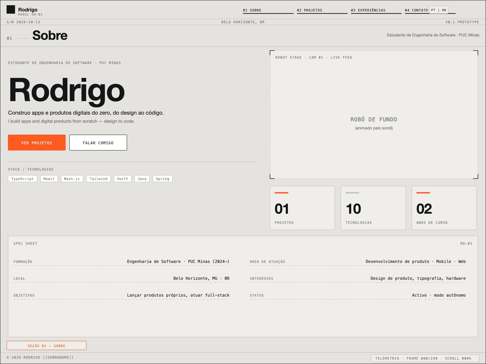 | 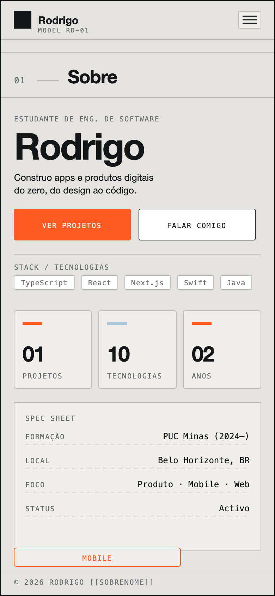 |
| 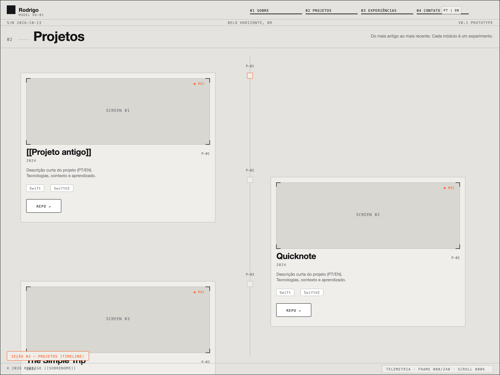 | 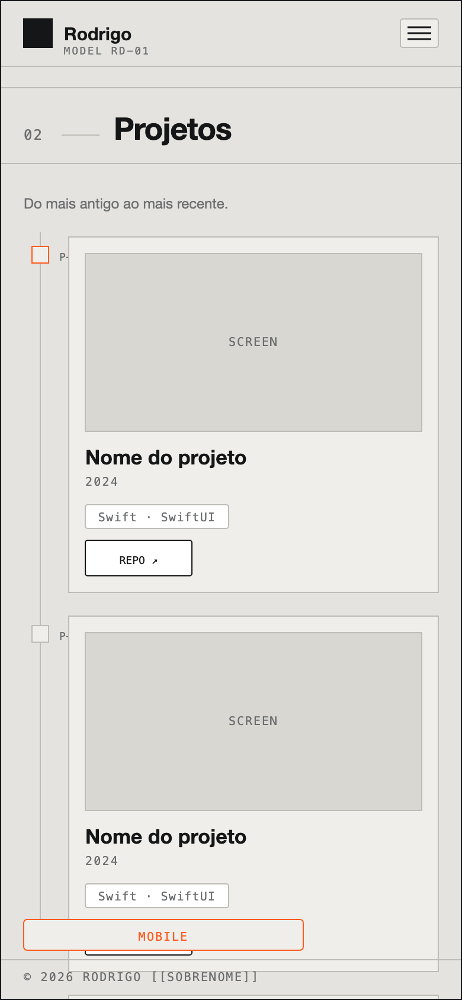 |
| 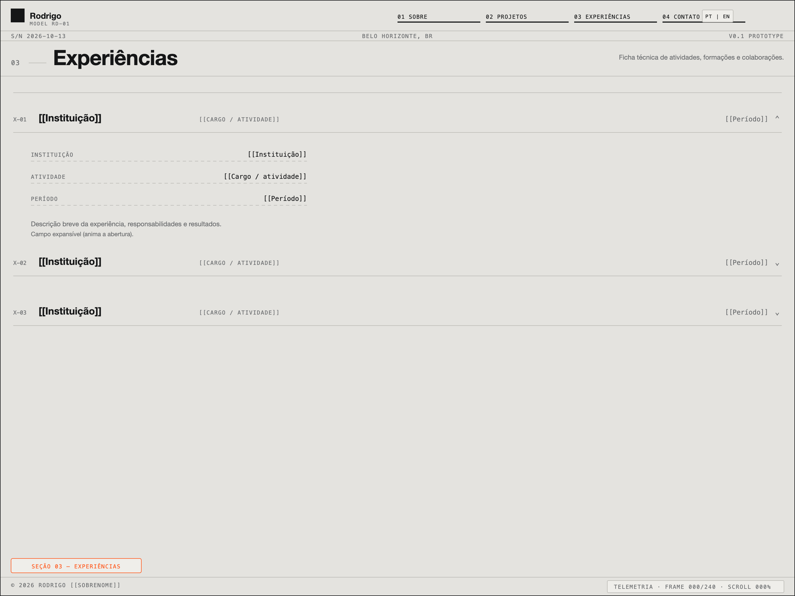 | 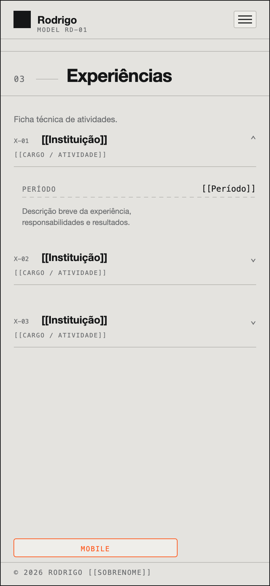 |
| 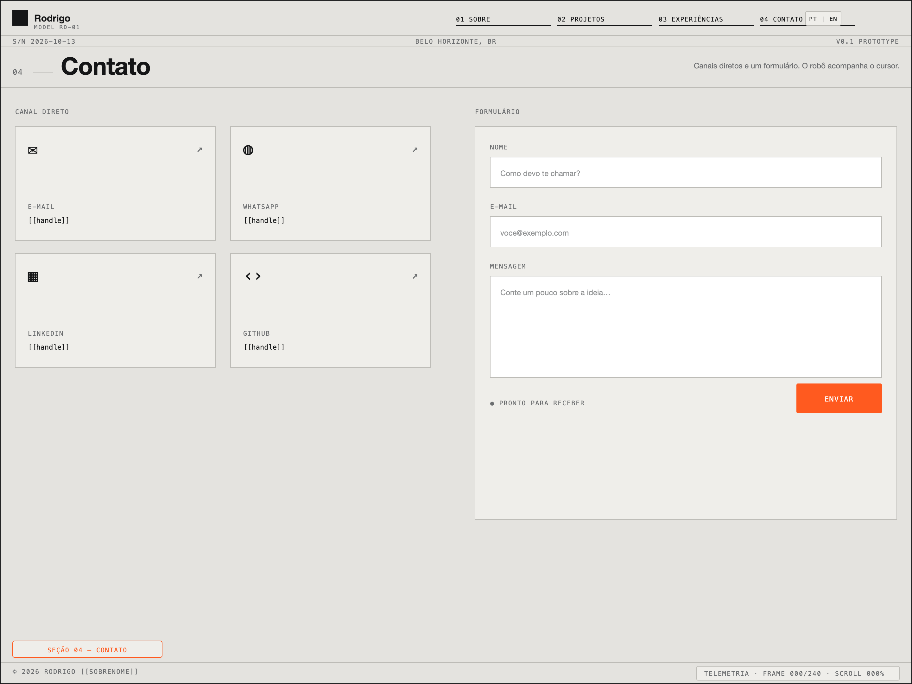 | 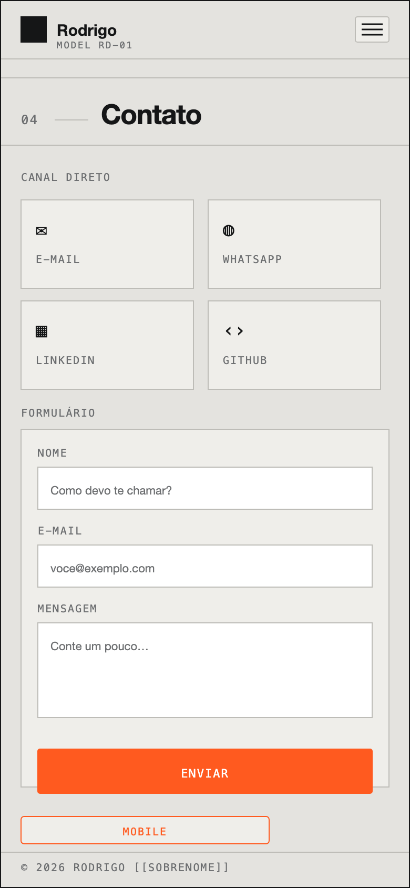 |

## Tecnologias

| Camada | Tecnologia |
| --- | --- |
| Framework | Next.js 15 (App Router), React 19 |
| Linguagem | TypeScript (estrito) |
| Estilo | Tailwind CSS v4 (tokens em `globals.css`), shadcn/ui |
| Animação | Framer Motion |
| Formulário | React Hook Form + Zod |
| E-mail | EmailJS (`@emailjs/browser`) |
| Capturas | Playwright |

## Arquitetura

- **Página única** com âncoras; sem back-end próprio.
- **Dados em `src/data/`** (`projects`, `experiences`, `contact`, `i18n`,
  `robot`): todo o conteúdo é editável sem tocar nos componentes.
- **i18n** próprio: dicionário tipado, Context e persistência.
- **Robô** desacoplado: `RobotBackdrop` (canvas fixo) lê o scroll, faz *lerp*
  para a inércia e publica a telemetria num *store* externo consumido pelo
  `TelemetryHUD` (`useSyncExternalStore`).
- **Frames opcionais:** o robô funciona em modo procedural 2D; se existirem
  frames WebP em `public/frames/robot/`, ele usa a sequência sem mudar código.

## Instalação e execução

Pré-requisitos: **Node 20+** e npm.

```bash
npm install
cp .env.example .env.local   # opcional (EmailJS); sem isso o form é simulado
npm run dev                  # http://localhost:3000
npm run build && npm start   # build de produção
npm run lint                 # ESLint
```

### Dependências principais

Lidas do `package.json`:

| Pacote | Versão | Papel |
| --- | --- | --- |
| `next` | 15.5.27 | Framework (App Router) |
| `react` / `react-dom` | 19.1.0 | UI |
| `typescript` | ^5 | Tipagem estrita |
| `tailwindcss` | ^4 | Estilo |
| `@tailwindcss/postcss` | ^4 | Pipeline do Tailwind v4 |
| `shadcn` | ^4.21.4 | Componentes |
| `@base-ui/react` | ^1.9.0 | Primitivos de UI |
| `framer-motion` | ^12.43.0 | Animações |
| `react-hook-form` | ^7.90.0 | Formulário |
| `@hookform/resolvers` + `zod` | ^5.9.1 / ^4.6.7 | Validação |
| `@emailjs/browser` | ^5.0.3 | Envio de e-mail |
| `lucide-react` | ^1.56.0 | Ícones |
| `sonner` | ^2.0.8 | Toasts |
| `clsx` + `tailwind-merge` + `cn` | ^2.1.1 / ^3.7.0 / ^0.4.0 | Classes utilitárias |
| `eslint` + `eslint-config-next` | ^9 / 15.5.27 | Lint |
| `playwright` | ^1.64.0 | Capturas e verificação |

### Variáveis de ambiente

```bash
NEXT_PUBLIC_EMAILJS_SERVICE_ID=
NEXT_PUBLIC_EMAILJS_TEMPLATE_ID=
NEXT_PUBLIC_EMAILJS_PUBLIC_KEY=
NEXT_PUBLIC_SITE_URL=            # opcional: URL pública (metadataBase/OG)
```

## Deploy

Publicado na **Vercel**. Acesso: **`[[URL DO SITE]]`**.

Passo a passo:

1. Suba o repositório para o GitHub.
2. Em <https://vercel.com/new>, importe o repositório (framework detectado:
   Next.js; build `next build`; sem configuração extra).
3. Em **Settings → Environment Variables**, adicione as 3 chaves do EmailJS
   (opcionalmente `NEXT_PUBLIC_SITE_URL`).
4. **Deploy**. A URL `*.vercel.app` fica pronta em ~1 minuto.

Alternativa por CLI:

```bash
npx vercel        # preview
npx vercel --prod # produção
```

## Testes e verificação

Não há suíte de testes unitários; a verificação é feita com type-check/lint e
scripts Playwright no repositório:

```bash
npm run build                          # inclui type-check
npm run lint
node scripts/check-overflow.mjs        # garante zero rolagem horizontal em 375/768/1280/1920
node scripts/capture.mjs               # regenera docs/prototipo (capturas + scroll.gif)
node scripts/wireframes.mjs            # regenera docs/wireframes (SVG + PNG)
```

## Estrutura de pastas

```
src/
  app/            layout, page (4 seções), globals.css
  components/     RobotBackdrop, TelemetryHUD, Header, Footer, seções, primitivos
  components/ui/  primitivos shadcn/ui
  data/           projects, experiences, contact, i18n, robot
  hooks/          useScrollProgress, useActiveSection, useReducedMotion
  lib/            frames (carregamento progressivo), robot-store, i18n-context
public/frames/robot/   manifest.json + frames (vazio no protótipo → fallback 2D)
docs/
  wireframes/     wireframes SVG/PNG + LEIA-ME.md
  prototipo/      capturas (sobre, projetos, experiencias, contato, mobile) + scroll.gif
  render-guide.md como produzir/trocar os frames do robô
scripts/          capture.mjs, check-overflow.mjs, wireframes.mjs
```

## Demonstração

Capturas do protótipo atual (Playwright, 1440×900 e 390×844) em
[`docs/prototipo/`](docs/prototipo/).

| Sobre | Projetos |
| --- | --- |
| 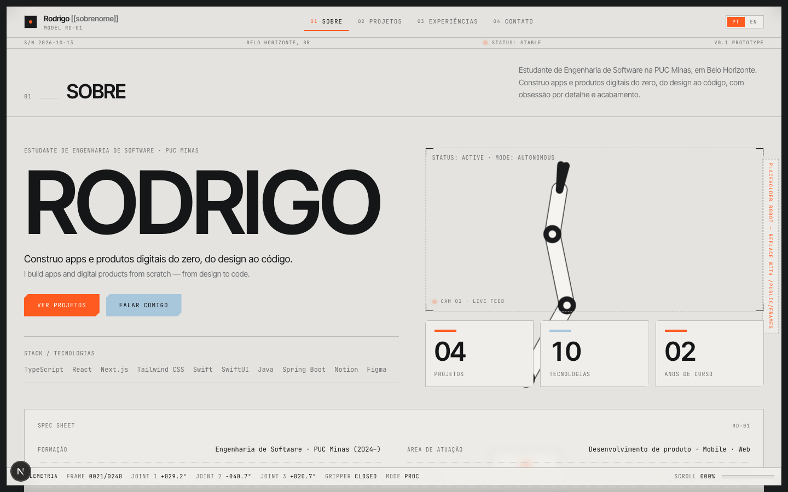 | 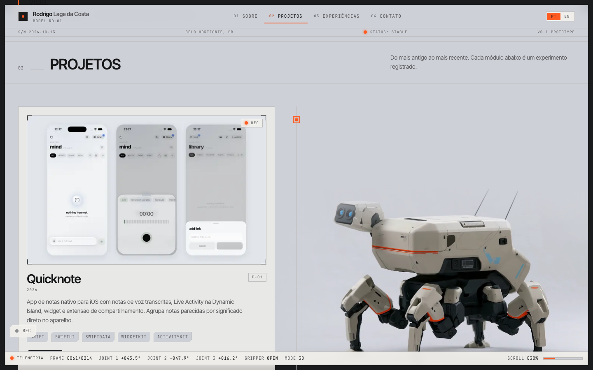 |

| Experiências | Contato |
| --- | --- |
| 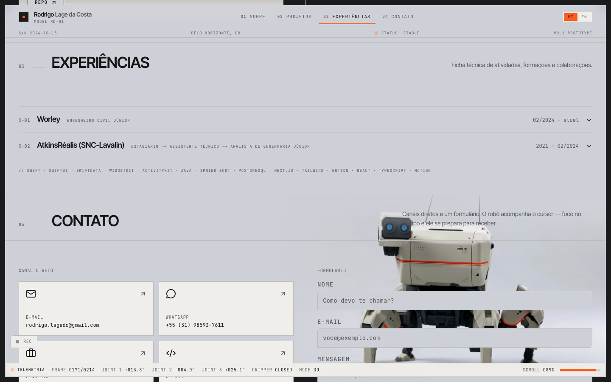 | 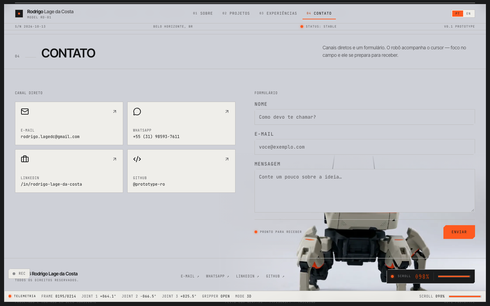 |

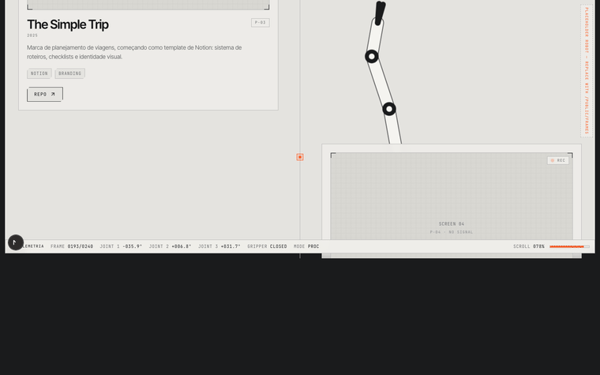

## Planejamento das sprints

| Sprint | Escopo | Status |
| --- | --- | --- |
| **Lab01S01** | Repositório, wireframes, protótipo navegável, layout e robô (fallback 2D) | ✅ |
| **Lab01S02** | Sobre bilíngue, timeline de projetos, experiências, formulário validado, EmailJS | ✅ |
| **Lab01S03** | Deploy na Vercel, acabamento visual, capturas, README final | ⏳ |

## O robô de fundo

O `RobotBackdrop` (canvas fixo, `aria-hidden`) usa uma sequência de frames
mapeada ao scroll, com **inércia (lerp)** e telemetria em tempo real.

- **Sem frames** (padrão do protótipo): desenha um robô procedural 2D — mesmo
  mapeamento e inércia. Marca `PLACEHOLDER ROBOT` no canto.
- **Com frames**: coloque os WebP em `public/frames/robot/{desktop,mobile}/` e
  ligue `placeholder: false` em `manifest.json`. Nenhum código muda.

Interações: parallax do mouse (desktop), hover nos cartões (empurrão),
foco no formulário e envio com sucesso. `prefers-reduced-motion` desativa o
movimento. Detalhes em [`docs/render-guide.md`](docs/render-guide.md).

## O que ainda é placeholder

Ver [`CONTEUDO-PENDENTE.md`](CONTEUDO-PENDENTE.md). Em resumo: nome/e-mail/
telefone/links e textos marcados `[[...]]` em `src/data/`, imagens dos projetos
(caixas 16:10 com `SCREEN 0N`) e link do Figma.

## Autores

**Rodrigo [[sobrenome]]** — Engenharia de Software, PUC Minas.
Orientação: Prof. João Paulo Aramuni (DIAW).

## Documentação usada

- Next.js — App Router, Metadata e Fonts: <https://nextjs.org/docs>
- React 19: <https://react.dev>
- Tailwind CSS v4: <https://tailwindcss.com/docs>
- shadcn/ui: <https://ui.shadcn.com>
- Framer Motion: <https://motion.dev>
- React Hook Form + Zod: <https://react-hook-form.com> · <https://zod.dev>
- EmailJS (`@emailjs/browser`): <https://www.emailjs.com/docs>
- Produção dos frames do robô: [`docs/render-guide.md`](docs/render-guide.md)
- Roteiro da apresentação: [`docs/apresentacao.md`](docs/apresentacao.md)

## Agradecimentos

- Prof. **João Paulo Aramuni** (DIAW/PUC Minas), pelo enunciado e pelas
  referências.
- Comunidade dos projetos open source acima, pela documentação.

## Licença

Distribuído sob a licença **MIT** — ver [`LICENSE`](./LICENSE). Projeto de uso
acadêmico, com identidade e textos originais.
